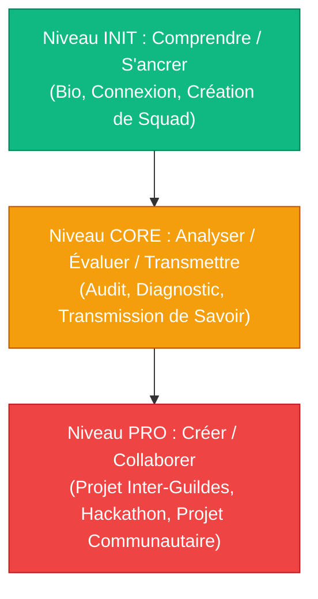

# 🧠 Fondations Neuro-Pédagogiques & Architecture de l'Évolution HASHCODE

Ce document rassemble les principes fondamentaux de neurologie cognitive, de sociométrie et d'ingénierie d'apprentissage active qui structurent la plateforme HASHCODE. Il sert de **référence stratégique et de guide théorique** pour la présentation du projet et le pitch investisseurs / partenaires.

---

## 🎨 1. Ingénierie Pédagogique Active (Modèle Socio-Constructiviste)

L'architecture d'apprentissage de HASHCODE rejette les schémas académiques descendants passifs au profit du **Learning-by-Doing** et de la **Taxonomie de Bloom révisée**.



### L'Échafaudage de la Taxonomie de Bloom
*   **Niveau INIT (Comprendre & Appliquer) :** Les premières missions (`Ancrage Initial`, `Profil Complet`) minimisent la friction cognitive d'entrée pour favoriser une activation immédiate.
*   **Niveau CORE (Analyser & Évaluer) :** L'apprenant applique le **principe de Feynman** à travers des quêtes comme `Transmission de Savoir`. En expliquant un concept complexe à d'autres, il solidifie ses propres structures cognitives et passe d'un état de récepteur passif à un rôle de transmetteur actif.
*   **Niveau PRO (Créer & Collaborer) :** Représente l'apogée de l'apprentissage constructiviste. L'apprenant doit composer avec des contraintes réelles, synchroniser ses compétences avec d'autres profils au sein de projets pluridisciplinaires, et créer des livrables fonctionnels.

### Zone Proximale de Développement (ZPD) & Échafaudage Social
L'isolement de l'apprenant est la cause principale de l'abandon en ligne (jusqu'à 90% sur les MOOCs classiques). HASHCODE introduit les **Squads** pour agir comme un **échafaudage social** (*social scaffolding*). Les pairs guident et tirent l'apprenant vers le haut à travers sa zone d'évolution immédiate, en comblant le fossé entre ce qu'il sait faire seul et ce qu'il peut accomplir au contact du collectif.

---

## ⚡ 2. Neurobiologie de l'Action & Circuit de la Récompense

Le cerveau n'apprend que lorsqu'il est engagé chimiquement. HASHCODE active de manière équilibrée les trois principaux neuromodulateurs de l'apprentissage :

```
   [Dopamine] (Attente / Défi) ──> [Acétylcholine] (Attention focalisée) ──> [Sérotonine] (Validation sociale)
```

### Le Hack Dopaminergique & La Boucle de Rétroaction
*   **La Boucle Courte (Dopamine - Motivation) :** Alimentée par les `Weekly Challenges`. L'intervalle de récompense régulier et accessible libère de la dopamine (molécule de la poursuite et de l'anticipation), maintenant un flux continu de motivation et neutralisant la procrastination.
*   **La Boucle Longue (Sérotonine - Accomplissement) :** Alimentée par la complétion de quêtes de haut niveau (`Première Preuve de Maîtrise`). L'évaluation, les feedbacks et l'intégration dans la guilde déclenchent une libération de sérotonine liée au statut social et au sentiment d'utilité publique.
*   **Attention Focalisée & Neuroplasticité par l'Erreur (Acétylcholine) :** HASHCODE valide uniquement les **preuves réelles de travail** (repositories GitHub, URL de production, designs Figma réels). La confrontation avec les contraintes techniques concrètes force le cerveau à commettre des erreurs, ce qui libère de l'acétylcholine pour marquer les réseaux de neurones défaillants et stimuler une réparation synaptique rapide (neuroplasticité adaptative).

---

## 🏰 3. L'Équation Système HASHCODE : Vibrancy, Drift, Confidence

Le moteur d'évolution HASHCODE repose sur trois indicateurs dynamiques calculés à partir de la typologie des quêtes accomplies.

```
                  ┌──────────────────────────────────────────────┐
                  │          Vibrancy  (Momentum actif)         │
                  │                     ▲                        │
                  │                     │                        │
                  │                     ▼                        │
   Drift (Polyvalence) ◄────────────────┼────────────────► Confidence (Certitude)
                  └──────────────────────────────────────────────┘
```

### 1. Vibrancy (L'Énergie Active)
Mesure la fréquence et l'assiduité des interactions avec le réseau. Ce vecteur garantit que l'apprenant conserve son élan cognitif en effectuant de micro-actions constantes (défis hebdomadaires, check-ins quotidiens de squad).

### 2. Drift (La Dérive Constructive : Profils en "T")
Mesure le niveau de versatilité cognitive de l'utilisateur. 
*   HASHCODE encourage le développement de profils en **T** (*T-Shaped Profiles*) : une expertise technique forte (la barre verticale) combinée à une capacité à comprendre d'autres langages et profils (la barre horizontale).
*   Des quêtes comme `Échange de Compétences` obligent les apprenants à s'aventurer en dehors de leur guilde d'origine pour acquérir des modèles mentaux secondaires (un développeur aidant un designer et vice versa).

### 3. Confidence (L'Indice de Certitude Objective)
Mesure la crédibilité des compétences acquises à travers des réalisations vérifiables. HASHCODE élimine le **biais de surconfiance (Dunning-Kruger)** et le sentiment d'imposture en basant toute progression sur des livrables évalués par les pairs, forgeant ainsi une légitimité professionnelle incontestable.

---

## 👥 4. L'Alchimie Neuro-Sociale des Squads de 5 Membres

Le **Squad** est le premier cercle de confiance de l'apprenant. Son efficacité repose sur deux piliers scientifiques :

### La Limite Sociométrique des 5 Membres
La taille des Squads est limitée à **5 membres**. En dynamique de groupe, le nombre de canaux de communication est défini par la formule : 

$$C = \frac{n(n-1)}{2}$$

```
   Membres (n)      Canaux (C)      Cohesion Interpersonnelle
   ───────────      ──────────      ─────────────────────────
        3                3          Faible résilience / Risque d'exclusion d'un tiers
        4                6          Structure intermédiaire
      [ 5 ]           [ 10 ]        LE POINT D'ÉQUILIBRE (Cohesion idéale)
        6               15          Surcharge cognitive de suivi
        8               28          Apparition de sous-clans / Dilution de l'attention
```

*   A **5 membres**, le nombre de canaux (10) permet une synchronisation parfaite sans surcharge de communication. Chaque membre connaît précisément les blocages de ses pairs.
*   **Neutralisation de la Flânerie Sociale (Effet Ringelmann) :** Dans des groupes plus larges, l'effort individuel diminue inconsciemment. À 5, la contribution et l'absence de contribution sont instantanément perceptibles, stimulant une dynamique d'entraide proactive sans hiérarchie autoritaire.

### La Symbiose Cognitive Pluridisciplinaire
HASHCODE réunit des profils complémentaires plutôt que similaires :

```
                  🧠 STRATEGIST (La Boussole)
                               │
            🛠️ BUILDER ────────┼──────── 🎨 CREATOR
         (L'Exécuteur)         │         (L'Esthète)
                               │
                  🗣️ CATALYST (Le Connecteur)
```

*   Cette organisation supprime la rivalité mimétique intra-groupe et installe une **dépendance mutuelle saine**.
*   Chaque membre endosse un rôle héroïque propre à sa guilde, développant une identité sociale forte et un sentiment profond de responsabilité collective.
*   **La Co-Évolution :** L'avancement individuel nourrit l'avancement global du Squad. La réussite n'est plus égoïste, elle devient communautaire, répliquant à l'échelle de la formation les dynamiques des meilleurs équipages de fondateurs de startup (*startup co-founders*).
