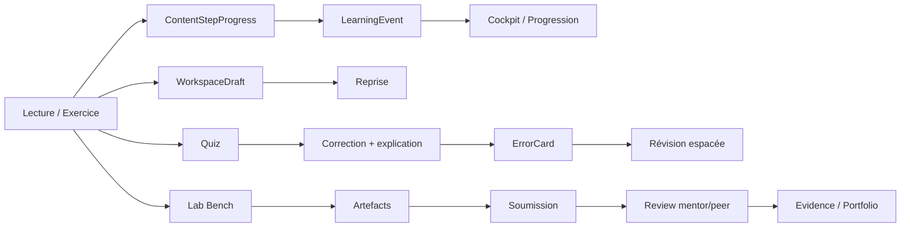

# Spécification — Espace d'apprentissage immersif HEF

> Date : 2026-11-05
> Périmètre : parcours HEF (17 modules, 169 missions, 17 labos, 17 projets, 17 évaluations finales)
> Objectif : un seul espace, sans quitter le site, pour apprendre, pratiquer, être corrigé,
> sauvegarder, reprendre, demander de l'aide et prouver ses compétences.
> Documents liés : `DOCS/AUDIT_LAB_SUBMISSIONS.md`,
> `DOCS/AUDIT_REMAINING_ISSUES.md`, `DOCS/WORKLOG_2026-11-05.md`.

---

## 1. Résumé exécutif

HEF n'est pas une bibliothèque de cours : c'est un **système d'entraînement** structuré.
Chaque mission suit 13 sections (histoire, objectifs, défi d'échauffement, concept, exemple,
exercice guidé, exercice solo, pièges, mini-boss, quiz éclair, réflexion, à retenir,
récompenses). Chaque module ajoute un labo, une évaluation finale et un projet.

L'application actuelle expose une partie de ce contenu, mais de façon **fragmentée** :

- la leçon est un long Markdown, pas un parcours en 13 étapes ;
- le quiz final existe, mais les **845 questions des quiz éclair** des 169 missions ne sont
  pas jouables ;
- les **338 questions de réflexion** ne sont pas collectées ;
- le playground Python est une iframe séparée, avec une progression en `localStorage` ;
- les labos sont des pages de mission avec **un seul lien** de soumission ;
- le forum, les notes, les quiz, les labos et les soumissions ne partagent pas le même état ;
- il n'existe pas d'espace membre pour contacter son mentor ;
- la CSP (`frame-src 'self'`) bloque tout outil externe embarqué.

**Recommandation :** construire un **HEF Learning Workspace** unique, avec 8 hubs
(Cockpit, Module, Lab Bench, Quiz & Correction, Evidence, Mentor, Progression, Communauté)
et une barre d'outils persistante. Réutiliser l'existant (Pyodide, CodeMirror, QuizPlayer,
forum, modèles Mentor, notifications) au lieu de recréer.

Chiffres clés de la source HEF :

| Élément | Volume |
|---|---:|
| Modules | 17 |
| Missions / chapitres | 169 |
| Sections pédagogiques par mission | 13 |
| Questions de quiz éclair (missions) | 845 |
| Questions de réflexion (missions) | 338 |
| Labos | 17 |
| Projets | 17 |
| Questions d'évaluation finale | 136 |
| Défis Python existants dans le playground | 17 |

---

## 2. Expérience cible

### 2.1 Le parcours utilisateur en une phrase

> J'arrive, je vois quoi faire aujourd'hui, je lis/je pratique dans le même écran, je suis
> corrigé immédiatement, je garde mes erreurs, je soumets mes preuves, mon mentor peut
> commenter, et je reprends exactement où j'en étais.

### 2.2 Les 8 hubs

| Hub | Rôle | Question de l'utilisateur |
|---|---|---|
| **Cockpit** | Aujourd'hui, reprise, prochaine action, mentor, notifications | « Je fais quoi maintenant ? » |
| **Module Workspace** | Les 13 étapes d'une mission + carte du module | « Où j'en suis dans ce module ? » |
| **Lab Bench** | Outils de pratique (code, SQL, terminal, Git, etc.) | « Je m'entraîne où ? » |
| **Quiz & Correction** | Quiz, corrections, explications, carnet d'erreurs, révision espacée | « Pourquoi je me suis trompé ? » |
| **Evidence Locker** | Preuves, soumissions, reviewers, portfolio | « Qu'est-ce que je peux prouver ? » |
| **Mentor Hub** | Mentor, disponibilités, chat, revue asynchrone, sessions | « Qui peut m'aider ? » |
| **Progression & Skills** | Compétences, maîtrise, temps, certificats | « Qu'est-ce que je maîtrise vraiment ? » |
| **Communauté & Recherche** | Forum, glossaire, recherche, aide | « Où est l'info / qui a déjà eu ce problème ? » |

### 2.3 Principes « sans quitter le site »

1. **Un seul shell** : navigation persistante, pas de rupture visuelle entre leçon, quiz, labo
   et soumission.
2. **Un dock d'outils** : Code, SQL, Terminal, Notebook, Tests, Notes, IA, Mentor, toujours
   accessible dans le contexte de la mission.
3. **Autosave partout** : code, réponses, notes, brouillons de labo, position de lecture.
4. **Reprise exacte** : le cockpit propose « Reprendre HEF-050 · Lab 01 · il y a 2 jours » et
   rouvre le bon outil, au bon endroit.
5. **Correction immédiate** : le quiz explique la bonne réponse et pourquoi chaque mauvaise
   option est fausse.
6. **Un seul fil d'événements** : chaque action d'apprentissage est journalisée pour la
   progression, le portfolio et les analytics.
7. **Sortie externe maîtrisée** : si un outil ne peut pas être embarqué, on ouvre un nouvel
   onglet avec un retour explicite vers la mission, et on récupère le résultat.

### 2.4 Wireframe cible

```text
┌──────────────────────────────────────────────────────────────────────────────┐
│ HEF · Module · Mission · Progression · Mentor · Notifications · Recherche   │
├───────────────┬──────────────────────────────────────────┬───────────────────┤
│ Carte du      │  Zone centrale                           │  Dock d'outils    │
│ module        │  - contenu / exercice / quiz / labo      │  [Code] [SQL]     │
│               │  - correction / commentaires             │  [Terminal]       │
│ 01 ✅         │  - artefacts / preuves                   │  [Tests] [Notes]  │
│ 02 ▶          │                                          │  [IA] [Mentor]    │
│ 03           │                                          │                   │
│ 04           │                                          │  Contexte:        │
│               │                                          │  mission, étape,  │
│               │                                          │  fichiers, erreurs│
├───────────────┴──────────────────────────────────────────┴───────────────────┤
│ Sauvegardé · 3/5 preuves · Prochaine action · Aide · Statut mentor            │
└──────────────────────────────────────────────────────────────────────────────┘
```

---

## 3. Audit de l'existant

### 3.1 Ce qui existe déjà

| Surface | Fichier / modèle | Ce qui marche | Limite |
|---|---|---|---|
| Catalogue Academy | `app/academy/page.tsx`, `courses/page.tsx` | 17 modules publiés, recherche visuelle | Pas de cockpit ni de reprise |
| Leçon | `app/academy/courses/[slug]/lessons/[contentId]/page.tsx` | Markdown, slides PDF, quiz final, notes, checklist | Leçon = un seul bloc, pas 13 étapes |
| Quiz final | `components/academy/quiz-player.tsx`, `app/api/academy/quizzes/[quizId]/attempt` | Score, correction option par option | Pas d'explication, pas de commentaire, pas de carnet d'erreurs |
| Playground Python | `public/playground/*`, `app/academy/playground/page.tsx` | Pyodide, 17 défis, indices, pas à pas, XP local | Iframe séparée, `localStorage`, pas de lien avec le compte |
| Espace de travail leçon | `components/academy/lesson-workspace.tsx` | Notes, checklist, marquer terminé | Pas d'autosave du code, pas de reprise d'outil |
| Labos | `app/missions/[id]/*`, `MissionSubmission` | Soumission + review | Un seul `content` (voir audit dédié) |
| Forum | `components/academy/module-discussions.tsx`, `Forum*` | Sujets et posts par cours | Déconnecté de la leçon et du labo |
| Mentor | `MentorProfile`, `MentorMatch`, `app/api/admin/mentoring` | Modèles et API admin | Aucune page membre, aucune session/chat |
| IA | `AIConversation`, `AIMessage` | Modèles présents | Aucune UI, aucun usage |
| Progression | `Progress` (isCompleted, note, checklist) | Persistance de base | Pas d'événements, pas de compétences, pas de reprise |
| Notifications | `Notification`, QStash, Resend | In-app + email | Pas de rappels d'étude ni de sessions mentor |
| Portfolio | `app/dossier/page.tsx`, `MissionSubmission` | Preuves de missions | Pas d'artefacts multi-preuves |
| CSP | `next.config.mjs` | Sécurité stricte | `frame-src 'self'` bloque les outils externes |

### 3.2 Les 10 écarts majeurs

1. **Leçon linéaire vs parcours en 13 étapes** : la structure pédagogique HEF est perdue.
2. **Quiz éclair absent** : 845 questions de mission non jouables.
3. **Réflexion absente** : 338 questions non collectées.
4. **Corrections muettes** : la bonne réponse est affichée, mais pas le pourquoi.
5. **Pas de carnet d'erreurs** : les erreurs ne servent à rien après le quiz.
6. **Pas de révision espacée** : pourtant prévue par la pédagogie HEF.
7. **Playground déconnecté** : progression locale, pas de sauvegarde serveur.
8. **Labos mono-lien** : impossible de rendre code + rapport + tableau + réflexion.
9. **Mentor invisible** : les modèles existent, l'expérience membre aussi.
10. **Outils externes bloqués** : CSP, pas de stratégie d'embed, pas de proxy.

---

## 4. Architecture cible

### 4.1 Routes proposées (sans nouvelle route racine)

HEF doit rester dans l'Academy, conformément à `DOCS/HEF_INTEGRATION.md`.
Proposition :

```text
/academy/workspace                         → Cockpit
/academy/workspace/[module]                → Module Workspace
/academy/workspace/[module]/[mission]      → Mission Player (13 étapes)
/academy/workspace/[module]/lab            → Lab Bench du module
/academy/workspace/[module]/assessment     → Évaluation finale
/academy/workspace/[module]/project        → Projet
/academy/workspace/labs                    → Catalogue des labos
/academy/workspace/labs/[slug]             → Lab Bench global
/academy/workspace/errors                  → Carnet d'erreurs
/academy/workspace/mentor                  → Mentor Hub
/academy/workspace/portfolio               → Evidence Locker
/academy/workspace/progress                → Compétences & maîtrise
```

Les pages publiques `/academy/courses`, `/academy/programme` restent inchangées.
Le workspace utilise un layout authentifié avec sidebar, sans le footer public.

### 4.2 Modèle de données à ajouter

```prisma
// 1. Les 13 étapes d'une mission (Content = chapitre HEF)
model ContentStep {
  id          String   @id @default(cuid())
  contentId   String
  content     Content  @relation(fields: [contentId], references: [id], onDelete: Cascade)
  key         String   // "histoire", "defi", "concept", "guide", "solo", "boss", "quiz"...
  order       Int
  type        String   // READING | EXERCISE | QUIZ | REFLECTION | SUMMARY
  title       String
  body        String?  @db.Text
  fields      Json     @default("[]")
  xp          Int      @default(0)
  isRequired  Boolean  @default(true)
  progress    ContentStepProgress[]

  @@unique([contentId, key])
  @@index([contentId, order])
  @@map("content_step")
}

model ContentStepProgress {
  id          String   @id @default(cuid())
  userId      String
  stepId      String
  step        ContentStep @relation(fields: [stepId], references: [id], onDelete: Cascade)
  status      String   @default("DRAFT") // DRAFT | DONE | NEEDS_REVIEW
  data        Json     @default("{}")
  score       Int?
  feedback    String?
  updatedAt   DateTime @updatedAt

  @@unique([userId, stepId])
  @@index([userId])
  @@map("content_step_progress")
}

// 2. Brouillons d'outils (code, SQL, notes, etc.)
model WorkspaceDraft {
  id          String   @id @default(cuid())
  userId      String
  contentId   String?
  missionId   String?
  tool        String   // PYTHON | SQL | TERMINAL | GIT | NOTEBOOK | DIAGRAM...
  state       Json
  version     Int      @default(1)
  updatedAt   DateTime @updatedAt

  @@unique([userId, contentId, tool])
  @@index([userId, updatedAt])
  @@map("workspace_draft")
}

// 3. Événements d'apprentissage (ou extension d'ActivityLog)
model LearningEvent {
  id          String   @id @default(cuid())
  userId      String
  type        String   // LESSON_OPENED | STEP_DONE | QUIZ_ANSWERED | CODE_RUN...
  moduleId    String?
  contentId   String?
  missionId   String?
  stepKey     String?
  metadata    Json?
  createdAt   DateTime @default(now())

  @@index([userId, createdAt])
  @@index([type, createdAt])
  @@map("learning_event")
}

// 4. Carnet d'erreurs + révision espacée
model ErrorCard {
  id            String   @id @default(cuid())
  userId        String
  sourceType    String   // MISSION_QUIZ | FINAL_QUIZ | LAB | CODE
  sourceId      String
  question      String
  selected      String?
  correct       String?
  explanation   String?
  concept       String?
  status        String   @default("OPEN") // OPEN | REVIEWING | MASTERED
  ease          Float    @default(2.5)
  intervalDays  Int      @default(1)
  nextReviewAt  DateTime @default(now())
  createdAt     DateTime @default(now())
  updatedAt     DateTime @updatedAt

  @@index([userId, nextReviewAt])
  @@index([userId, status])
  @@map("error_card")
}

// 5. Mentor : sessions et messages
model MentorSession {
  id          String   @id @default(cuid())
  mentorId    String
  menteeId    String
  startsAt    DateTime
  endsAt      DateTime
  status      String   @default("SCHEDULED") // SCHEDULED | DONE | CANCELLED
  meetingUrl  String?
  notes       String?  @db.Text
  feedback    String?  @db.Text
  createdAt   DateTime @default(now())

  @@index([mentorId, startsAt])
  @@index([menteeId, startsAt])
  @@map("mentor_session")
}

model MentorMessage {
  id          String   @id @default(cuid())
  matchId     String
  senderId    String
  body        String   @db.Text
  readAt      DateTime?
  createdAt   DateTime @default(now())

  @@index([matchId, createdAt])
  @@map("mentor_message")
}

// 6. Compétences / preuves
model Skill {
  id        String   @id @default(cuid())
  key       String   @unique
  label     String
  moduleId  String?
  evidences SkillEvidence[]

  @@map("skill")
}

model SkillEvidence {
  id          String   @id @default(cuid())
  skillId     String
  submissionId String?
  level       String   // EXPLORER | PRACTITIONER | BUILDER | ENGINEER | ARCHITECT
  validatedAt DateTime @default(now())

  @@unique([skillId, submissionId])
  @@map("skill_evidence")
}
```

> Les modèles `CourseQuiz`, `CourseQuestion`, `CourseOption`, `CourseQuizAttempt` existent
> déjà. Il suffit d'ajouter `explanation` sur `CourseQuestion`, `feedback` sur `CourseOption`,
> et de créer un `CourseQuiz` par mission (quiz éclair) en plus du quiz final.

### 4.3 Flux de données



---

## 5. Les outils à mettre à disposition

### 5.1 Vue par module

| Module | Outil principal | Outils secondaires | Correction |
|---|---|---|---|
| HEF-000 | Python Lab (debug, timers) | Notebook, notes, carnet d'erreurs | Tests + review |
| HEF-010 | Python Lab (algorithmes) | Test runner, complexité | Tests auto |
| HEF-020 | Python Lab (structures) | Visualiseur BST/heap/hash, benchmark | Tests auto |
| HEF-030 | Python Lab + profiler | Graphiques, notebook | Tests + mesures |
| HEF-040 | CPU/cache simulator | Convertisseur binaire/hex, Mermaid | Tests auto |
| HEF-050 | Terminal Linux | Process explorer, permissions | Scénarios auto |
| HEF-060 | Network Lab | API client, DNS/TCP visualizer | Scénarios auto |
| HEF-070 | SQL Lab (SQLite/PGlite) | Schema designer, EXPLAIN visualizer | Requêtes + tests |
| HEF-080 | Git Lab | Diff/review, métriques de complexité | Tests + review |
| HEF-090 | Parser Lab | AST visualizer, grammaire EBNF | Tests auto |
| HEF-100 | Security Lab | Analyseur statique, CVSS, Juice Shop | Attaques/tests |
| HEF-110 | Test Lab | Couverture, mutation, CI simulator | Tests + mutation |
| HEF-120 | Docker/CI Lab | Pipeline visualizer, observabilité | Audit + simulation |
| HEF-130 | Profiler + SQL Lab | Load test simulator, notebook | Mesures + garde-fous |
| HEF-140 | Distributed Lab | Fault injector, trace viewer | Invariants auto |
| HEF-150 | Product Lab | Interview board, metric tree, RICE, A/B calculator | Critères exécutés |
| HEF-160 | AI Lab | Prompt playground, RAG evaluator, agent trace | Évaluation + attaques |

### 5.2 Les 12 outils first-party à construire

#### 1. Python Lab
- **But** : écrire, exécuter, tester et déboguer du Python.
- **Base existante** : `public/playground` (Pyodide, CodeMirror, tests, indices, pas à pas).
- **À ajouter** :
  - intégration dans le shell (pas iframe nue) ;
  - sauvegarde du code et de l'état dans `WorkspaceDraft` ;
  - exécution serveur autoritaire (Piston/Judge0) pour les tests notés ;
  - bouton « Vérifier » qui crée un artefact de test ;
  - mode « expliquer mon erreur » (IA) ;
  - partage d'un lien de code.
- **Modules** : HEF-000, 010, 020, 030, 040, 050, 060, 080, 090, 100, 110, 130, 140, 150, 160.
- **Priorité** : P0.

#### 2. SQL Lab
- **But** : écrire un schéma, insérer des données, exécuter des requêtes, lire un plan.
- **Tech** : `sql.js` (SQLite WASM) ou `@electric-sql/pglite` (PostgreSQL WASM).
- **Fonctions** :
  - éditeur SQL avec autocomplétion ;
  - base pré-remplie par module ;
  - résultat en tableau, export CSV ;
  - `EXPLAIN` / plan visualisé ;
  - comparaison avant/après index ;
  - tests de requêtes.
- **Modules** : HEF-070, HEF-130.
- **Priorité** : P1.

#### 3. Terminal Lab
- **But** : pratiquer Linux, processus, permissions, réseau, Docker.
- **Tech** :
  - `xterm.js` pour l'UI ;
  - backend sandboxé (conteneur éphémère par utilisateur, `ttyd`/`wetty`) ;
  - ou simulateur de système de fichiers pour les exercices guidés ;
  - pour le réel : Killercoda/Play with Docker en secours.
- **Sécurité** : isolation réseau, quotas CPU/RAM/temps, destruction après session, aucun secret.
- **Modules** : HEF-050, HEF-060, HEF-120.
- **Priorité** : P1 (simulateur), P2 (vrai terminal).

#### 4. Git Lab
- **But** : initialiser un dépôt, commits conventionnels, branches, merges, diff, PR.
- **Tech** : `isomorphic-git` + `gitgraph.js` pour le graphe ; GitHub API pour les vrais dépôts.
- **Fonctions** :
  - dépôt virtuel dans le navigateur ;
  - historique visuel ;
  - diff avant/après ;
  - simulation de PR et de review ;
  - export vers GitHub.
- **Modules** : HEF-080, HEF-120.
- **Priorité** : P1.

#### 5. Docker / CI Lab
- **But** : écrire un Dockerfile, simuler un pipeline, observer un déploiement canary.
- **Tech** :
  - `dockerfile-ast` + `hadolint` (WASM ou serveur) pour l'audit ;
  - simulateur de pipeline en TypeScript (graphe de jobs, cache, chemin critique) ;
  - Play with Docker/Killercoda pour le réel.
- **Fonctions** : audit de Dockerfile, graphe CI, logs, SLI/SLO, DORA, rollback.
- **Modules** : HEF-120.
- **Priorité** : P2.

#### 6. Network Lab
- **But** : comprendre TCP/HTTP/DNS, diagnostiquer des pannes.
- **Tech** :
  - simulateur de paquets et de handshake (TypeScript) ;
  - client HTTP/API intégré (fetch runner) ;
  - éventuellement proxy vers un serveur local sandboxé.
- **Fonctions** : scénarios de panne, diagnostic en couches, codes HTTP, latence.
- **Modules** : HEF-060.
- **Priorité** : P2.

#### 7. Notebook Lab
- **But** : analyses de données, mesures, graphiques, rapports reproductibles.
- **Tech** : JupyterLite (Pyodide) ou `@nteract` ; stockage `.ipynb` dans R2/S3.
- **Fonctions** : cellules, sorties, graphiques (matplotlib/vega-lite), export HTML/PDF.
- **Modules** : HEF-030, HEF-130, HEF-150, HEF-160.
- **Priorité** : P2.

#### 8. Diagram Studio
- **But** : schémas d'architecture, Mermaid, modèles de menaces, story maps.
- **Tech** : Mermaid (déjà utilisé), Excalidraw embarqué, export PNG/SVG.
- **Fonctions** : éditeur Mermaid, aperçu live, sauvegarde, insertion dans un rapport.
- **Modules** : HEF-040, 070, 080, 120, 140, 150.
- **Priorité** : P1.

#### 9. Test & Profiler Lab
- **But** : écrire des tests, mesurer la couverture, tuer des mutants, profiler.
- **Tech** :
  - `pytest`/`unittest` dans Pyodide ou Piston ;
  - `coverage.py` (serveur) ;
  - mutation testing custom (mutmut-like) ;
  - `cProfile` + `pstats` + flamegraph ;
  - `EXPLAIN` SQL.
- **Modules** : HEF-030, HEF-110, HEF-130.
- **Priorité** : P1/P2.

#### 10. Security Lab
- **But** : auditer une application jouet, attaquer, corriger, rejouer.
- **Tech** :
  - application jouet locale (Python/Flask ou Node) sandboxée ;
  - analyseur statique (`ast`/Semgrep) ;
  - CVSS calculator ;
  - OWASP Juice Shop auto-hébergé pour les exercices avancés ;
  - CTFd pour les challenges.
- **Modules** : HEF-100.
- **Priorité** : P2.

#### 11. AI Lab
- **But** : utiliser un assistant, vérifier, évaluer, sécuriser.
- **Tech** :
  - proxy serveur vers un LLM (OpenAI/Anthropic/Google) ;
  - RAG avec pgvector sur le contenu HEF ;
  - trace viewer (journal d'outils, tokens, coût) ;
  - banc d'évaluation (jeu dev/test, intervalles) ;
  - banc d'attaques (prompt injection, data leakage).
- **Modules** : HEF-160, + tuteur IA transversal.
- **Priorité** : P2.

#### 12. Product Lab
- **But** : cadrer un problème, interviewer, définir des métriques, décider.
- **Tech** :
  - tableau d'entretiens (faits/opinions/thèmes) ;
  - arbre de métriques ;
  - calculateur de taille d'échantillon / A/B ;
  - RICE calculator ;
  - mémo de décision exportable.
- **Modules** : HEF-150.
- **Priorité** : P2.

### 5.3 Les outils transversaux

| Outil | Rôle | Priorité |
|---|---|---|
| **AI Tutor** | Explique, questionne, corrige sans donner la solution ; cite le cours | P1 |
| **Error Notebook** | Garde chaque erreur, l'explique, la fait réviser | P0 |
| **Spaced Repetition** | Revoit les erreurs et concepts à intervalles croissants (SM-2) | P1 |
| **Search / Command Palette** | Cherche dans les modules, glossaires, erreurs, forum | P1 |
| **Mentor Hub** | Contact, chat, booking, revue asynchrone | P0 (carte) / P1 (chat) |
| **Evidence Locker** | Preuves multi-artefacts, portfolio | P0 (base) |
| **Notes & Bookmarks** | Notes par mission, favoris, export | P0 |
| **Notifications** | Rappels d'étude, corrections, sessions mentor | P1 |
| **Offline / PWA** | Lire et coder hors ligne, synchroniser | P2 |
| **Accessibility** | Clavier, lecteur d'écran, contraste, sous-titres | P0 |

---

## 6. Quiz, corrections et commentaires

### 6.1 État actuel

- `QuizPlayer` affiche le score et la bonne option.
- `CourseQuestion.explanation` existe dans le schéma, mais n'est pas rempli.
- `CourseOption` n'a pas de feedback.
- `CourseQuizAttempt` stocke les réponses et le score, mais l'historique n'est pas visible.
- Les 845 questions des quiz éclair ne sont pas importées.
- Les 338 questions de réflexion ne sont pas collectées.

### 6.2 Cible

Pour chaque question :

1. **Bonne réponse** mise en évidence.
2. **Explication** : pourquoi c'est correct.
3. **Feedback par option** : pourquoi chaque mauvaise option est fausse.
4. **Commentaire personnalisé** : « tu as choisi B, qui confond symptôme et problème ».
5. **Lien vers la section du cours** qui explique le concept.
6. **Carte d'erreur** créée automatiquement.
7. **Révision espacée** programmée (J+1, J+3, J+7, J+14…).
8. **Mode examen** (correction à la fin) vs **mode entraînement** (correction immédiate).

### 6.3 Travail de contenu

| Contenu | Volume | Action |
|---|---:|---|
| Questions de quiz éclair | 845 | Parser + importer + explications |
| Questions d'évaluation finale | 136 | Ajouter explications + feedbacks |
| Questions de réflexion | 338 | Parser + champs texte + revue |
| Exercices guidés / solo / mini-boss | 676 | Parser + champs + indices/solutions |

Les explications peuvent être générées par IA **puis relues** par un humain. Ne jamais
publier une explication non vérifiée.

### 6.4 Modèle de données

```prisma
model CourseQuestion {
  // ...
  explanation String? @db.Text
}

model CourseOption {
  // ...
  feedback String? @db.Text // pourquoi cette option est fausse
}
```

Le reste (attempts, scores) existe déjà.

---

## 7. Labs et preuves

Voir l'audit dédié : `DOCS/AUDIT_LAB_SUBMISSIONS.md`.

Résumé :

- un labo = 3 à 5 artefacts (code, rapport, tableau, log, réflexion) ;
- `MissionSubmissionArtifact` + `Mission.submissionSchema` ;
- formulaire dynamique, upload, validation serveur ;
- review par artefact + critères du labo ;
- auto-check HEF-010 uniquement au départ ;
- backfill des anciennes soumissions.

Le Lab Bench doit être le même shell que la mission : l'utilisateur ouvre le labo, code,
lance les tests, écrit son rapport, joint ses fichiers, puis soumet sans changer de page.

---

## 8. Mentor Hub

### 8.1 Côté membre

- **Ma fiche mentor** : nom, expertise, bio, disponibilités, note.
- **Prochaine session** : date, lien visio, ordre du jour, notes.
- **Chat asynchrone** : question courte, capture d'écran, lien vers le code.
- **Demande de revue** : « Peux-tu relire mon lab HEF-050 ? » avec artefact joint.
- **Historique** : sessions, feedback, décisions.
- **Demande de mentor** : si aucun match, formulaire de matching.
- **Règles** : réponse sous 48 h, pas de debug urgent, code de conduite.

### 8.2 Côté mentor

- **Mes mentorés** : progression, blocages, prochaine action.
- **File de revue** : labos/projets en attente.
- **Disponibilités** : créneaux, durée, visio.
- **Sessions** : notes, feedback, décision.
- **Qualité** : taux de réponse, satisfaction, charge.

### 8.3 Côté admin

- **Matching** : compétences, domaine, charge, langue.
- **Capacité** : `maxMentees`, `currentMentees`.
- **Qualité** : feedback, litiges, inactivité.
- **Paiement** : mentorat 1:1 payant (D-018), validation des preuves gratuite.

### 8.4 Intégrations

| Besoin | Outil recommandé |
|---|---|
| Réservation | Cal.com (self-hosted ou cloud) |
| Visio | LiveKit, Daily, ou Jitsi |
| Chat | WebSocket/Stream ou messages en base |
| Rappels | Resend + notifications in-app |
| Paiement | Stripe (si mentorat payant) |

> D-022 : le chat WhatsApp reste la couche communautaire. Le Mentor Hub est la couche
> **suivi et preuve**, pas un remplacement du groupe.

---

## 9. Progression, analytics et gamification

### 9.1 Événements à journaliser

```text
LESSON_OPENED, STEP_STARTED, STEP_COMPLETED, EXERCISE_ATTEMPTED,
QUIZ_STARTED, QUIZ_ANSWERED, QUIZ_COMPLETED, QUIZ_RETRIED,
ERROR_CARD_CREATED, ERROR_CARD_REVIEWED, ERROR_CARD_MASTERED,
CODE_RUN, TEST_RUN, TEST_PASSED, TEST_FAILED,
LAB_STARTED, ARTIFACT_UPLOADED, SUBMISSION_SENT,
REVIEW_RECEIVED, REVISION_SENT,
MENTOR_REQUESTED, MENTOR_SESSION_BOOKED, MENTOR_MESSAGE_SENT,
PORTFOLIO_VIEWED, CERTIFICATE_ISSUED
```

### 9.2 Compétences et maîtrise

- Compétences dérivées des modules (algorithmes, systèmes, réseaux, DB, sécurité, etc.).
- Niveaux : Explorer → Practitioner → Builder → Engineer → Architect → Mentor.
- Une compétence est validée par une **evidence** (labo/projet approuvé), pas par un quiz.
- Le quiz mesure la compréhension ; l'evidence mesure la capacité.

### 9.3 Gamification

- Respecter D-015 : pas de leaderboard global, pas de streak générique, pas de XP global.
- Utiliser les XP **pédagogiques HEF** par mission (5/10/20/40/15/10) comme feedback local.
- Badges de module et de compétence, pas de classement public.
- Le portfolio et les evidences sont la vraie monnaie.

### 9.4 Cockpit « Aujourd'hui »

Affiche :

1. **Reprendre** : dernière activité, temps écoulé, bouton.
2. **Prochaine action** : la prochaine étape non terminée du module courant.
3. **Objectif de la semaine** : 2 missions, 1 labo, 1 quiz.
4. **Erreurs à réviser** : nombre de cartes dues aujourd'hui.
5. **Mentor** : prochaine session / message non lu.
6. **Preuves** : dernières soumissions, statuts.
7. **Série d'étude** (si conservée) : locale, pas de compétition.

---

## 10. Services internet et infrastructure

### 10.1 Services à intégrer

| Service | Usage | Recommandation | Priorité | Coût / risque |
|---|---|---|---|---|
| **Exécution de code** | Tests autoritaires, labs | Piston (self-hosted), Judge0, E2B, Modal | P1 | Coût CPU, sécurité |
| **LLM** | Tuteur, explications, revue | OpenAI/Anthropic/Google via proxy serveur | P1 | Tokens, hallucination |
| **Embeddings / RAG** | Recherche sémantique, tuteur | pgvector (Postgres) ou Qdrant | P1 | Stockage, coût |
| **Stockage fichiers** | Artefacts, notebooks, vidéos | Cloudflare R2 (S3-compatible) | P0 | Egress, quotas |
| **Vidéo** | Cours, démos, sessions | Mux / Cloudflare Stream | P2 | Coût, DRM |
| **Visio** | Mentorat | LiveKit / Daily / Jitsi | P1 | Coût, permissions |
| **Calendrier** | Booking mentor | Cal.com | P1 | Intégration |
| **Email** | Notifications, rappels | Resend (déjà) | P0 | Déjà en place |
| **Notifications** | In-app + push | QStash (déjà) + Web Push | P1 | Abonnements |
| **Recherche** | Modules, glossaire, forum | Meilisearch/Typesense ou Postgres FTS | P1 | Indexation |
| **Analytics** | Comportement, drop-off | PostHog (self-hosted/cloud) | P2 | RGPD |
| **Erreurs** | Monitoring | Sentry | P1 | Coût |
| **Certificats** | PDF + vérification | `@react-pdf/renderer` | P2 | Design |
| **Paiement** | Mentorat 1:1 | Stripe | P2 | Conformité |
| **CDN / WAF** | Perf, sécurité | Cloudflare (déjà) | P0 | Déjà en place |
| **Monitoring** | Uptime | Uptime Kuma (déjà) | P0 | Déjà en place |

### 10.2 Outils externes à référencer (pas forcément à embarquer)

| Domaine | Références utiles | Mode |
|---|---|---|
| Python | docs.python.org, Real Python | Liens |
| Algorithmes | visualgo.net, Big-O Cheat Sheet | Embed/lien |
| SQL | SQLite docs, PostgreSQL docs, DB Fiddle | Embed/lien |
| Linux | explainshell.com, man pages | Lien |
| Réseaux | MDN, RFC, Wireshark docs | Lien |
| Git | Git docs, GitHub Skills | Lien |
| Docker | Play with Docker, Killercoda | Embed/lien |
| Sécurité | OWASP, PortSwigger, Juice Shop, CTFtime | Embed/lien |
| Produit | Figma, Excalidraw, Miro | Embed/lien |
| IA | OpenAI/Anthropic docs, Hugging Face | Lien |
| Accessibilité | WCAG, axe | Interne |

> Règle : un outil externe n'est embarqué que s'il est **indispensable**, **sûr**, et
> **intégrable dans la CSP**. Sinon, lien sortant + retour explicite.

### 10.3 CSP et sécurité

Allowlist actuelle (#442, `next.config.mjs`, verrouillée par `__tests__/csp-headers.test.ts`) :

| Domaine autorisé | Directives | Usage réel |
|---|---|---|
| `https://cdn.jsdelivr.net/npm/pyodide@0.26.4/` | `script-src`, `connect-src` | Pyodide (worker `public/playground/worker.js`) |
| `https://cdnjs.cloudflare.com/ajax/libs/codemirror/5.65.16/` | `script-src`, `style-src` | CodeMirror 5 de `public/playground/index.html` |
| `https://fonts.googleapis.com`, `https://fonts.gstatic.com` | `style-src`, `font-src` | Polices du playground (l'app passe par `next/font`, auto-hébergé) |
| `https://static.cloudflareinsights.com`, `https://cloudflareinsights.com` | `script-src`, `connect-src` | Beacon Cloudflare Web Analytics, injecté par le proxy |
| `https://lh3.googleusercontent.com`, `https://avatars.githubusercontent.com`, `https://api.qrserver.com` | `img-src` | Avatars OAuth et QR codes (dérivé de `images.remotePatterns`) |

Directives fermées : `default-src 'self'`, `object-src 'none'`, `frame-src 'self'`,
`frame-ancestors 'self'`, `base-uri 'self'`, `form-action 'self'`. Retirés par #442 :
`https://*.pyodide.org` et `https://pypi.org` (micropip non utilisé), jsDelivr et cdnjs
sans chemin (n'importe quel paquet npm aurait pu être chargé), jsDelivr dans
`style-src`/`font-src` (inutilisé). PostHog est appelé côté serveur (`lib/analytics.ts`),
il n'a donc rien à faire dans `connect-src`.

Toute bibliothèque CDN est épinglée par version dans la CSP : changer la version de
Pyodide ou de CodeMirror impose de mettre à jour `next.config.mjs` dans le même commit.

Pour embarquer des outils, il faudra :

- ajouter les domaines nécessaires à `frame-src` (Cal.com, Figma, etc.) ;
- garder `frame-ancestors 'self'` ;
- passer les appels LLM/sandbox par le serveur (pas de clé côté client) ;
- isoler les sandboxes (pas de réseau, quotas, destruction) ;
- journaliser les accès ;
- limiter le rate limiting par utilisateur ;
- ne jamais exposer de secrets dans les iframes.

---

## 11. Roadmap

### P0 — Le socle immersif (4–6 semaines)

- [ ] Layout `/academy/workspace` avec sidebar + dock.
- [ ] Cockpit « Aujourd'hui » + reprise.
- [ ] Mission Player en 13 étapes (lecture, exercices, quiz, réflexion).
- [ ] Import des 845 questions de quiz éclair.
- [ ] Import des 338 questions de réflexion.
- [ ] Explications + feedbacks sur les 136 questions finales.
- [ ] Carnet d'erreurs (création + consultation).
- [ ] Sauvegarde du code/notes dans `WorkspaceDraft`.
- [ ] Carte mentor (sans chat) + demande de mentor.
- [ ] Multi-artefacts labo (voir audit dédié).
- [ ] CSP : autoriser les premiers embeds nécessaires.

### P1 — La boucle d'entraînement (6–10 semaines)

- [ ] SQL Lab.
- [ ] Terminal Lab (simulateur).
- [ ] Git Lab.
- [ ] AI Tutor (RAG + citations + mode socratique).
- [ ] Révision espacée (SM-2) + « refaire mes erreurs ».
- [ ] Mentor Hub : chat + booking Cal.com.
- [ ] Evidence Locker : artefacts + portfolio.
- [ ] Recherche globale / command palette.
- [ ] Notifications d'étude et de session.

### P2 — Les labos avancés (8–12 semaines)

- [ ] Docker/CI Lab.
- [ ] Network Lab.
- [ ] Security Lab + Juice Shop.
- [ ] AI Lab (traces, évaluation, attaques).
- [ ] Notebook Lab.
- [ ] Diagram Studio.
- [ ] Test & Profiler Lab.
- [ ] Product Lab.

### P3 — L'écosystème (continu)

- [ ] Analytics PostHog + dashboards.
- [ ] Certificats PDF + vérification publique.
- [ ] PWA / offline.
- [ ] Sessions live de cohorte.
- [ ] Marketplace de mentors (paiement).
- [ ] API publique / intégrations.

---

## 12. Décisions à prendre

1. **Construire ou embarquer** chaque outil ? Recommandation : first-party pour Python, SQL,
   Git, tests, diagrammes ; embed pour Docker, sécurité, visio.
2. **Exécution serveur ou navigateur** ? Recommandation : navigateur pour l'apprentissage
   immédiat, serveur pour les tests notés et les labs.
3. **Quel LLM et quel coût** ? Recommandation : proxy serveur, modèle économique pour le
   tuteur, modèle plus fort pour les reviews, quotas par utilisateur.
4. **Mentor humain ou IA-first** ? Recommandation : IA pour l'aide immédiate, humain pour la
   validation et le déblocage.
5. **Contenu des explications** : qui rédige/relit les 845 + 136 explications ?
6. **Mobile/PWA** : le workspace doit-il être utilisable sur téléphone ? Recommandation : oui
   pour la lecture et les quiz, non pour le terminal.
7. **Conservation des données** : combien de temps garder les brouillons, events, messages ?
8. **CSP** : quels domaines autoriser, et qui valide la sécurité ?

---

## 13. Critères d'acceptation

- [ ] Un membre peut faire une mission HEF de bout en bout sans quitter `/academy/workspace`.
- [ ] Les 13 sections d'une mission sont navigables et sauvegardées.
- [ ] Les 845 questions de quiz éclair sont jouables.
- [ ] Chaque question affiche une explication et un feedback par option.
- [ ] Les 338 questions de réflexion sont collectées.
- [ ] Chaque erreur crée une carte de révision.
- [ ] Le code du playground est sauvegardé côté serveur et reprenable.
- [ ] Le cockpit affiche « Reprendre » avec le bon outil et le bon état.
- [ ] Un labo peut recevoir code + rapport + tableau + réflexion.
- [ ] Le reviewer voit chaque artefact et commente par artefact.
- [ ] Un membre peut contacter son mentor, demander une revue et réserver une session.
- [ ] Le portfolio affiche les preuves multi-artefacts.
- [ ] Les outils externes sont intégrés sans casser la CSP.
- [ ] Les données sont exportables et supprimables (RGPD).

---

## 14. Risques

| Risque | Impact | Mitigation |
|---|---|---|
| Sandbox escape | Critique | Isolation, pas de réseau, quotas, destruction |
| Coût LLM / CPU | Élevé | Quotas, cache, modèles économiques, self-hosted |
| Hallucination IA | Élevé | RAG + citations + validation humaine |
| Contenu non maintenu | Moyen | Source HEF versionnée + gate CI |
| Surcharge de features | Élevé | Roadmap P0→P3, pas de big bang |
| Mentor indisponible | Moyen | IA-first + escalation + SLA |
| CSP trop permissive | Élevé | Allowlist, revue sécurité, proxy serveur |
| RGPD | Élevé | Export/suppression, rétention, consentement |
| Mobile | Moyen | Design responsive, PWA, pas de terminal mobile |

---

## 15. Ce qu'il ne faut pas faire

- Ne pas construire un nouveau LMS complet : réutiliser `Course`, `Content`, `Progress`,
  `CourseQuiz`, `Mission`, `Forum`, `MentorProfile`.
- Ne pas mettre tous les outils dans des iframes externes : privilégier le first-party.
- Ne pas créer un leaderboard global ou des streaks génériques (D-015).
- Ne pas remplacer WhatsApp (D-022).
- Ne pas auto-approuver un labo parce qu'un test passe.
- Ne pas afficher une correction sans explication.
- Ne pas stocker la progression critique dans `localStorage`.
- Ne pas ouvrir un terminal réel sans isolation et quotas.

---

## 16. Annexes

### A. Taxonomie des événements

Voir §9.1.

### B. Mapping des 13 sections

| Section | Type | Interaction | XP HEF |
|---|---|---|---:|
| 🎬 L'histoire | READING | Lecture | 0 |
| 🎯 Ta mission | READING | Objectifs | 0 |
| 🧩 Défi d'échauffement | EXERCISE | Texte libre / tentative | 5 |
| 💡 Le concept | READING | Lecture | 0 |
| 🔍 Exemple pas à pas | READING | Lecture | 0 |
| ✍️ À toi, avec aide | EXERCISE | Champs + indices | 10 |
| 🚀 À toi, en solo | EXERCISE | Champs / code | 20 |
| ⚠️ Pièges classiques | READING | Lecture | 0 |
| 🐉 Mini-boss | EXERCISE | Livrable | 40 |
| ⚡ Quiz éclair | QUIZ | 5 questions | 15 |
| 🪞 Je réfléchis | REFLECTION | 2 questions | 10 |
| 🎒 À retenir | SUMMARY | Lecture | 0 |
| 🏅 Récompenses | SUMMARY | Badge | 0 |

### C. Références internes

- `DOCS/HEF_INTEGRATION.md` — import du curriculum.
- `DOCS/AUDIT_LAB_SUBMISSIONS.md` — soumission multi-artefacts.
- `DOCS/DECISIONS.md` — D-015, D-017, D-018, D-022, D-024.
- `public/playground/README.md` — playground existant.
- `EDUCATION-SYSTEM/01-Pedagogy/README.md` — principes pédagogiques.
- `EDUCATION-SYSTEM/05-Assessment/README.md` — chaîne d'évaluation.
- `08-Standards/HEF-Style-Ludique.md` — structure des 13 sections.
- `00-Program/Graduation-Requirements.md` — conditions de diplôme.
