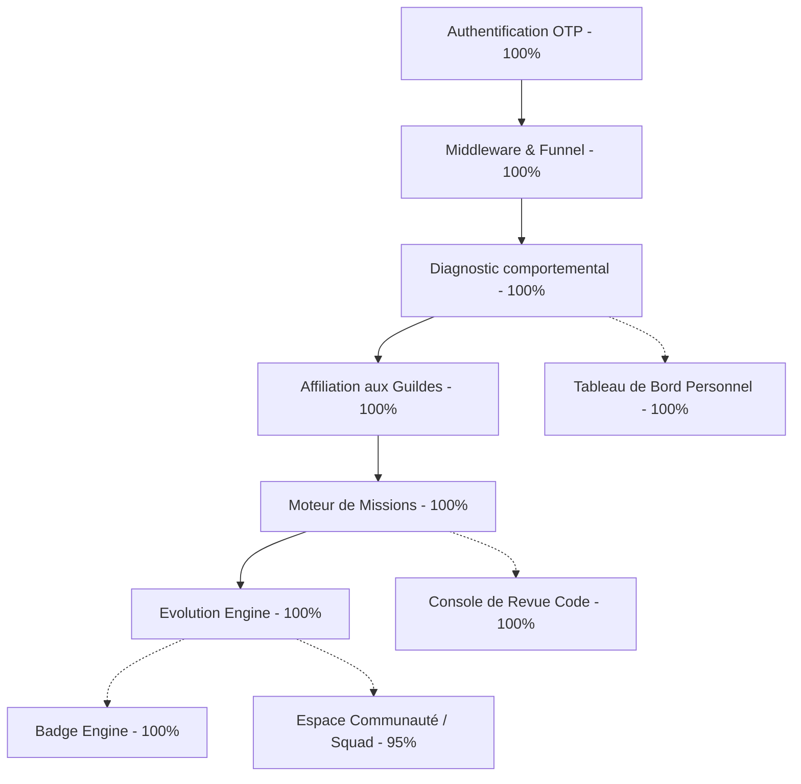

# Carte d'Architecture & Diagnostic Technique HASHCODE ⚡

Ce document sert de **source de vérité officielle** sur l'architecture technique, les dépendances applicatives et le niveau de développement (complétion) des fonctionnalités de HASHCODE.

---

## 1. Le Noyau Vital (6 Fonctionnalités Critiques)

Ces fonctionnalités forment l'infrastructure centrale et valident le flux utilisateur complet. Elles sont indispensables au fonctionnement de la plateforme.

| Fonctionnalité                   | Rôle dans le Flux Utilisateur                                                                                                         | Fichiers Clés                                      | Complétion |
| :------------------------------- | :------------------------------------------------------------------------------------------------------------------------------------ | :------------------------------------------------- | :--------: |
| **1. Authentification OTP**      | Porte d'entrée sécurisée et sans mot de passe via l'envoi d'un code unique à 8 caractères à usage temporaire.                         | `lib/auth.ts` `components/auth/signin-form.tsx` |  **100%**  |
| **2. Middleware de Funnel**      | Filtre et redirige dynamiquement les utilisateurs vers l'étape suivante obligatoire de leur inscription (pays, situation, puis quiz). | `middleware.ts`                                    |  **100%**  |
| **3. Diagnostic Psychométrique** | Analyse comportementale en 13 questions de scénarios complexes pour identifier les traits dominants et le score de cohérence.         | `lib/analysis.ts` `components/quiz/quiz.tsx`    |  **100%**  |
| **4. Affiliation aux Guildes**   | Inscription transactionnelle atomique (via Prisma `$transaction`) de l'utilisateur à sa guilde associée au profil dominant.           | `app/actions/quiz.ts`                              |  **100%**  |
| **5. Moteur de Missions**        | Système d'affichage et de soumission de preuves de travail (liens GitHub ou texte) spécifiques à la Guilde de l'apprenant.            | `lib/missions.ts` `app/missions/page.tsx`       |  **100%**  |
| **6. Évolution Engine**          | Moteur de calcul de l'activité réelle en temps réel via des concepts de _Vibrancy_ (activité), _Drift_ (dérive) et _Confidence_.      | `lib/evolution.ts` `lib/evolution-engine.ts`    |  **100%**  |

---

## 2. Les Systèmes Dépendants (4 Fonctionnalités Périphériques)

Ces fonctionnalités s'articulent autour du noyau vital pour offrir une expérience utilisateur collaborative et gamifiée.

### A. Espace Communauté & Gestion des Escouades (Squads) — **95%**

- **Dépendance** : _Authentification (1)_ & _Middleware (2)_
- **Description** : Permet aux membres de former des groupes autonomes de 5 personnes pour collaborer. Il gère la cohésion d'équipe (perte automatique de cohésion de 2% par jour d'inactivité) et attribue des récompenses collectives en cas de "streak" élevé.
- **État** : backend complet (`lib/squad-logic.ts`) et base de données 100% opérationnels. Frontend fluide (les 5% restants correspondent aux ajustements de suppression de l'étape intermédiaire post-quiz que nous venons de simplifier).

### B. Moteur de Badges & Succès (Badge Engine) — **100%**

- **Dépendance** : _Moteur de Missions (5)_ & _Évolution (6)_
- **Description** : Décerne de manière autonome des récompenses visuelles en cas d'atteinte de jalons clés (Initié au niveau 2, Vétéran au niveau 5, Productif à 10 missions terminées).
- **État** : Entièrement opérationnel dans `lib/badge-engine.ts`, connecté à Prisma et couplé aux notifications systèmes en direct.

### C. Console de Revue (Reviewer Console) — **100%**

- **Dépendance** : _Moteur de Missions (5)_ & _Évolution (6)_
- **Description** : Interface dédiée aux administrateurs ou réviseurs pour lire, évaluer, accepter ou rejeter les preuves de travail de code et valider le gain d'XP correspondant.
- **État** : Entièrement opérationnelle sous `app/reviewer` et validée par la suite complète de tests automatiques.

### D. Tableau de Bord Personnel (User Dashboard) — **100%**

- **Dépendance** : _Diagnostic (3)_ & _Évolution (6)_
- **Description** : Le hub de contrôle central de l'utilisateur connecté, affichant son grade, sa barre de niveau dynamique, et recommandant ses prochaines missions.
- **État** : Entièrement modélisé et connecté avec succès.

---

## 3. Garantie de Stabilité Technique

Toute cette architecture technique est soumise à une suite de tests unitaires et d'intégration Vitest (`npm run test`), garantissant qu'aucune modification d'infrastructure ne puisse altérer ces flux critiques.
