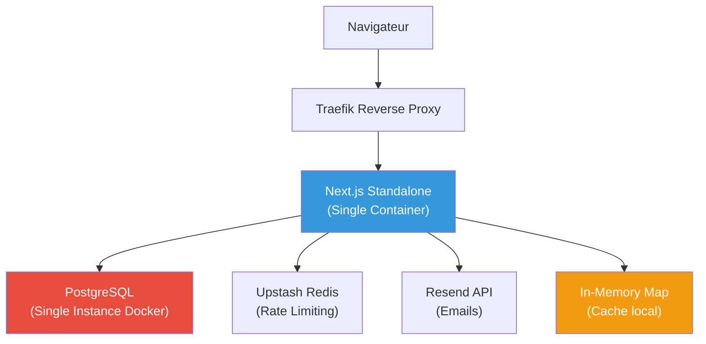
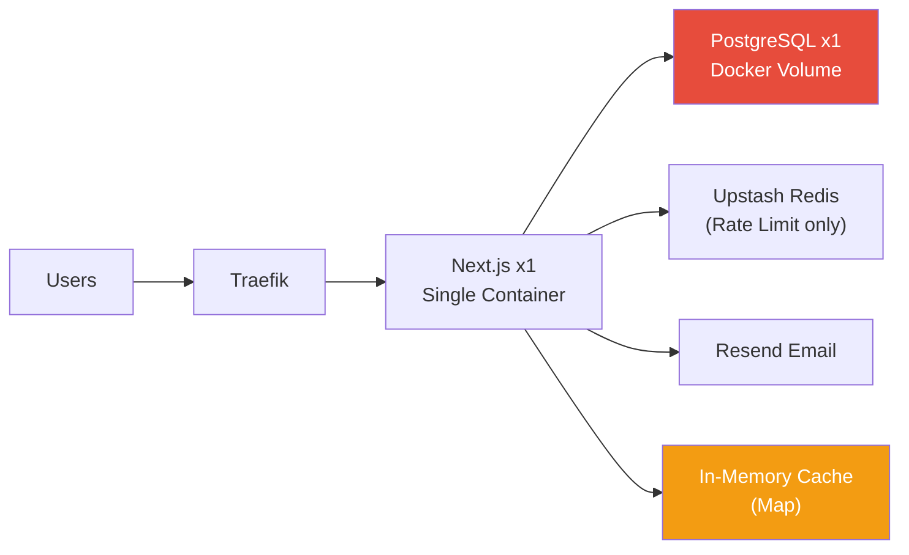
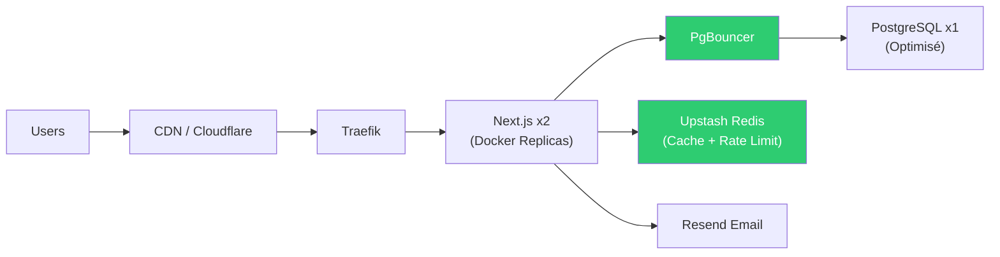
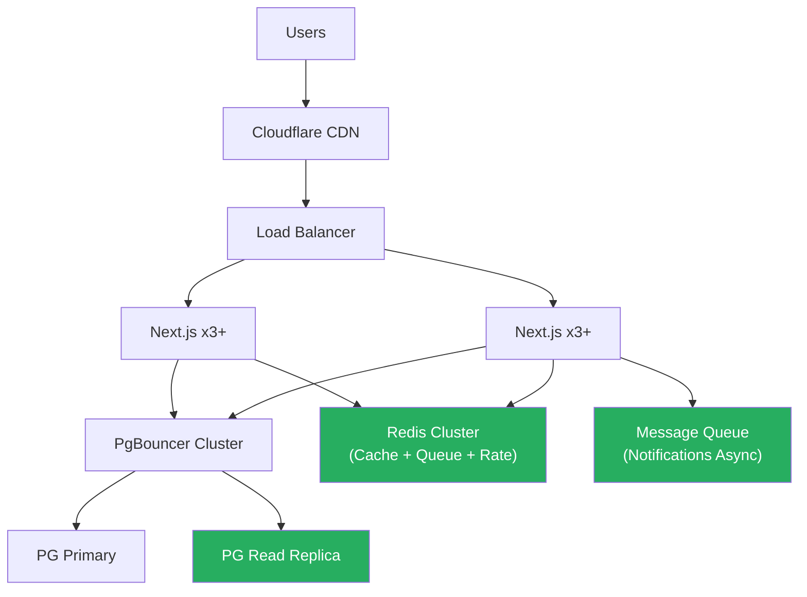
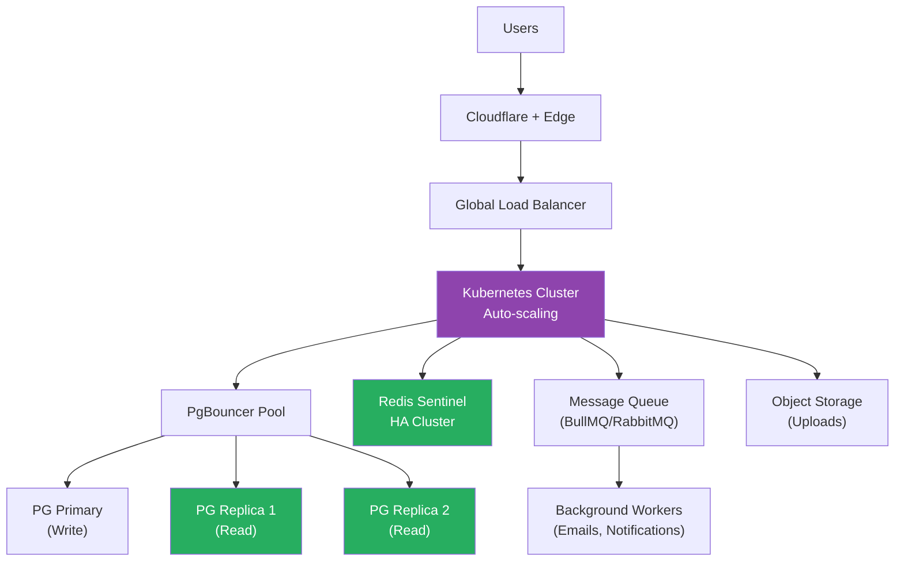
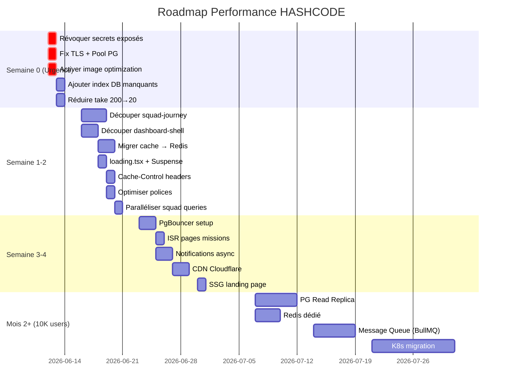

# Audit Performance & Scalabilité — JoinHashcode

Audit complet de la plateforme HASHCODE par un Architecte Performance Senior.
Objectif : déterminer la capacité de montée en charge à 100 / 1 000 / 10 000 / 100 000 utilisateurs.

---

## 🚨 Pré-Alerte Sécurité (Hors Scope mais Bloquant)

> [!CAUTION]
> Le fichier [.env.production](file:///c:/Users/PC/Documents/GitHub/hashcode-community/.env.production) **expose en clair** dans le repository Git :
> - Mots de passe PostgreSQL (`gZ9k6H80g7KUecd4MWd8Bj45Uu3WFFvT`)
> - Secrets Better Auth, Google, GitHub OAuth
> - Clés API Resend, QStash, Upstash Redis
> - Tokens KV Upstash
> 
> **ACTION IMMÉDIATE REQUISE** : Révoquer et régénérer TOUS ces secrets, puis les retirer du VCS. Utiliser des secrets Docker/Vault/variables d'environnement du runtime.

> [!WARNING]
> `NODE_TLS_REJECT_UNAUTHORIZED = "0"` dans [prisma.ts](file:///c:/Users/PC/Documents/GitHub/hashcode-community/lib/prisma.ts#L7) **désactive la vérification TLS globalement**. Ceci est une faille de sécurité en production (Man-in-the-Middle).

---

## PHASE 1 — Architecture Générale

### Vue d'ensemble

| Composant | Technologie | Version |
|---|---|---|
| Framework | Next.js (App Router) | 16.2.6 |
| Runtime | React | 19.x |
| BDD | PostgreSQL (auto-hébergé Docker) | via `pg` + Prisma 7 |
| ORM | Prisma 7 + `@prisma/adapter-pg` | 7.8.0 |
| Auth | Better Auth + Prisma Adapter | 1.6.15 |
| Cache applicatif | In-memory `Map` | — |
| Cache distribué | Upstash Redis (rate limiting uniquement) | — |
| Email | Resend | 6.12.3 |
| Notifications | Synchrone DB-direct (ex-QStash) | — |
| Hébergement | Docker (standalone Node.js) + Traefik | — |
| Analytics | Vercel Analytics | 1.6.1 |
| File Queue | Upstash QStash (signing keys présentes) | — |

### Diagramme de charge



### Points de charge identifiés

| Point | Criticité | Raison |
|---|---|---|
| **PostgreSQL single-node** | 🔴 CRITIQUE | Point de défaillance unique. Pas de réplication. |
| **Cache in-memory** | 🔴 CRITIQUE | Perdu à chaque redémarrage. Inutile avec >1 instance. |
| **Pas de connection pooling configuré** | 🟡 IMPORTANT | Pool `pg` sans `max`, idle timeout, etc. |
| **37 routes API force-dynamic** | 🟡 IMPORTANT | Aucune mise en cache côté serveur sauf 1 route. |
| **Single container Next.js** | 🟡 IMPORTANT | Pas de horizontal scaling. |
| **Notifications synchrones** | 🟠 MOYEN | Chaque notification fait un write DB + email synchrone. |

---

## PHASE 2 — Frontend Performance

### Analyse des Core Web Vitals (estimation code-based)

| Métrique | Estimation | Cible | Verdict |
|---|---|---|---|
| **LCP** | ~2.5-3.5s | <2.5s | 🟡 Risque |
| **FCP** | ~1.5-2.5s | <1.8s | 🟡 Risque |
| **TTI** | ~3-5s | <3.8s | 🔴 Problème |
| **CLS** | ~0.05 | <0.1 | ✅ OK |
| **TBT** | ~400-800ms | <200ms | 🔴 Problème |

### Problèmes identifiés

#### 🔴 Composants surdimensionnés (JavaScript excessif)

| Fichier | Taille | Problème |
|---|---|---|
| [squad-journey.tsx](file:///c:/Users/PC/Documents/GitHub/hashcode-community/components/dashboard/squad-journey.tsx) | **74 KB** | Méga-composant monolithique, probablement >200KB après compilation |
| [dashboard-shell.tsx](file:///c:/Users/PC/Documents/GitHub/hashcode-community/components/dashboard/dashboard-shell.tsx) | **25 KB** | Tout le dashboard en un seul composant client |
| [email.ts](file:///c:/Users/PC/Documents/GitHub/hashcode-community/lib/email.ts) | **31 KB** | Templates HTML inline (server-side, mais contribue au bundle standalone) |
| [missions.ts](file:///c:/Users/PC/Documents/GitHub/hashcode-community/lib/missions.ts) | **36 KB** | Données statiques hardcodées (envoyées au client via props) |
| [app-sidebar.tsx](file:///c:/Users/PC/Documents/GitHub/hashcode-community/components/dashboard/app-sidebar.tsx) | **13 KB** | Sidebar complexe chargée sur chaque page |

#### 🟡 Images non optimisées

```javascript
// next.config.mjs L8
images: { unoptimized: true }
```

**`unoptimized: true` désactive TOUTE l'optimisation d'images Next.js** : pas de WebP/AVIF, pas de resize, pas de lazy loading natif. C'est le tueur n°1 de LCP.

#### 🟡 3 polices Google chargées

[layout.tsx](file:///c:/Users/PC/Documents/GitHub/hashcode-community/app/layout.tsx#L8-L24) charge **Syne** (5 poids), **Outfit** (5 poids), et **IBM Plex Mono** (4 poids) = **14 fichiers de polices**. Impact direct sur FCP.

#### 🟡 Re-renders potentiels

- `DashboardShell` reçoit `fullSubmissions` (tableau de 200 éléments max) comme props
- `NeuralFeed` est un composant client qui fait du fetch côté client sans déduplication
- Pas de `React.memo` ou `useMemo` sur les listes de composants lourds

#### 🟡 Animations CSS permanentes

Le CSS global inclut des animations `infinite` (`holo-sheen-sweep`, `hud-pulse`, `laser-sweep`, `grid-drift`, `hazard-sweep`) qui consomment du GPU en continu même quand elles ne sont pas visibles.

---

## PHASE 3 — Next.js Optimisation

### Analyse Server Components vs Client Components

| Zone | Type | Verdict |
|---|---|---|
| [app/page.tsx](file:///c:/Users/PC/Documents/GitHub/hashcode-community/app/page.tsx) (Landing) | Server + dynamic imports | ✅ Bien |
| [app/dashboard/page.tsx](file:///c:/Users/PC/Documents/GitHub/hashcode-community/app/dashboard/page.tsx) | Server (fetch) → Client shell | 🟡 Le shell est un méga-composant client |
| [app/missions/page.tsx](file:///c:/Users/PC/Documents/GitHub/hashcode-community/app/missions/page.tsx) | Server + `unstable_cache` | ✅ Bien |
| [app/squad/page.tsx](file:///c:/Users/PC/Documents/GitHub/hashcode-community/app/squad/page.tsx) | Server → Méga-composant client (74KB) | 🔴 Critique |

### Optimisations manquantes

| Technique | État | Impact |
|---|---|---|
| **Dynamic Imports** | Landing page uniquement | 🔴 Dashboard et Squad ne l'utilisent PAS |
| **Code Splitting** | Automatique par route, mais composants géants | 🟡 Chunks trop gros |
| **Streaming / Suspense** | Landing page uniquement | 🔴 Dashboard n'a PAS de loading UI granulaire |
| **ISR** | Pas utilisé | 🟡 Pages comme `/missions` pourraient en bénéficier |
| **SSG** | Pas utilisé | 🟡 Landing page pourrait être statique |
| **Route Handlers Cache** | 1/37 routes cached | 🔴 Critique — 97% des routes sont force-dynamic |
| **`unstable_cache`** | 1 seule utilisation (`getMissionsEnrichment`) | 🟡 Sous-exploité |

### Requêtes N+1 et waterfalls

#### Dashboard — 4 requêtes parallèles ✅

```typescript
// dashboard/page.tsx — Promise.all OK
[dbUser, quizResult, submissions, member] = await Promise.all([...])
```

Mais la requête `member` fait un **include nested** (organization → members → user) = potentiel JOIN lourd.

#### Squad Page — Waterfall 🔴

```typescript
// squad/page.tsx
const org = await auth.api.getFullOrganization(...); // Requête 1
if (!org) {
  const member = await prisma.member.findFirst({...}); // Requête 2 (conditionnel)
}
const dbUser = await prisma.user.findUnique({...}); // Requête 3 (TOUJOURS séquentiel)
```

**3 requêtes séquentielles** au lieu de parallèles.

---

## PHASE 4 — Base de Données

### Index existants (analyse du schema)

| Table | Index | Verdict |
|---|---|---|
| `user` | `email` (unique), `level`, `class`, `role`, `pseudo` (unique), `cardSignature` (unique), `referralCode` (unique), `memberNumber` (unique) | ✅ Correct |
| `session` | `token` (unique), `userId` | ✅ Correct |
| `mission_submission` | `status`, `userId`, `missionId`, `createdAt`, composite `userId_missionId_cycleKey` | ✅ Bon |
| `notification` | `userId`, `isRead`, `createdAt` | ✅ Correct |
| `activity_log` | `userId`, `action`, `createdAt`, composite `entity_entityId` | ✅ Bon |
| `daily_checkin` | `userId`, `createdAt` | ✅ Correct |

### Index manquants 🔴

| Table | Index manquant | Requête impactée |
|---|---|---|
| `mission` | `@@index([isWeeklyChallenge])` | `getCurrentWeeklyChallenge` fait un `findUnique` par slug, OK, mais `groupBy` sur `missionSubmission` filtre par `missionId` sans jointure indexée |
| `member` | `@@index([userId])` | Squad page fait `findFirst({ where: { userId } })` — PAS d'index ! |
| `organization` | `@@index([slug])` | Lookups par slug |
| `guild_member` | Composite `userId+guildId` existe | ✅ OK |

### Requêtes coûteuses identifiées

#### 1. Feed API — Full Table Scan potentiel 🟡

```typescript
// app/api/feed/route.ts
prisma.user.findMany({
  orderBy: { createdAt: "desc" },
  take: 10,
})
```

Sans filtre, PostgreSQL doit trier TOUTE la table `user` avant de retourner 10 résultats. À 100K utilisateurs = scan coûteux. `createdAt` n'a **pas d'index** sur la table `user`.

#### 2. Missions Page — 3 groupBy + 1 findMany en parallèle 🟡

```typescript
// getMissionsEnrichment — cached 5min
prisma.missionSubmission.groupBy({ by: ["missionId"], where: { status: "APPROVED" }, _count: ... })
prisma.missionSubmission.groupBy({ by: ["missionId"], where: { status: "APPROVED", userRating: { not: null } }, _avg: ... })
prisma.mission.findMany({ select: { id: true, slug: true } })
```

Caché 5 minutes, mais les `groupBy` sur `mission_submission` seront lents sans index composite `(status, missionId)`.

#### 3. Dashboard — `take: 200` submissions 🔴

```typescript
prisma.missionSubmission.findMany({
  where: { userId: session.user.id },
  include: { mission: { select: {...} } },
  take: 200,  // ← Pourquoi 200 ?
})
```

200 soumissions avec JOIN mission = transfert de données excessif. Probablement 5-10 suffiraient pour l'affichage.

#### 4. Notifications — 2 requêtes séparées 🟡

```typescript
const notifications = await prisma.notification.findMany({ where: { userId }, take: 10 });
const unreadCount = await prisma.notification.count({ where: { userId, isRead: false } });
```

Devrait être un seul `findMany` + calcul côté serveur.

### Problèmes de concurrence

- **Pas de `@updatedAt` sur `User`** au niveau Prisma → pas de détection de conflit optimiste
- Le `$transaction` dans la mission submit est correct ✅
- Le pool `pg` ne configure pas `max` (défaut = 10 connexions). Insuffisant au-delà de 100 requêtes concurrentes.

---

## PHASE 5 — Dashboard

### Temps de chargement estimé

| Étape | Durée estimée | Bottleneck |
|---|---|---|
| Auth session check | ~50-100ms | Cookie parsing + DB lookup |
| 4 requêtes DB en parallèle | ~200-500ms | Le plus lent = member avec nested include |
| Recommendation engine | ~5-20ms | In-memory calcul |
| Sérialisation + hydratation client | ~300-800ms | **25KB de composant client** |
| Polices + CSS animations | ~200-400ms | 14 fichiers de polices |
| **Total estimé** | **~800ms-1.8s** | Acceptable à 100 users |

### Ralentissements identifiés

1. **`NeuralFeed`** fait un fetch côté client vers `/api/feed` → waterfall supplémentaire après hydratation
2. **`DailyCheckinWidget`** est un composant `"use client"` qui fait du state management local
3. **`MemberCard`** avec animation holographique CSS permanente consomme du GPU
4. **fullSubmissions (200 items)** sérialisées dans le HTML initial → poids de la page HTML brute
5. **Pas de `loading.tsx`** dans le dossier squad → écran blanc pendant le chargement

---

## PHASE 6 — Supabase

> ⏩ **SKIPPED** — L'utilisateur confirme ne plus utiliser Supabase. La DB est maintenant PostgreSQL auto-hébergé via Docker.

---

## PHASE 7 — Simulation de Charge

### Modèle de charge

Basé sur l'architecture actuelle (single container, single DB, in-memory cache) :

| Scénario | Utilisateurs simultanés | Requêtes/sec estimées | Verdict |
|---|---|---|---|
| **100 users** | ~10-15 concurrent | ~30-50 req/s | ✅ **Fonctionne** |
| **1 000 users** | ~100-150 concurrent | ~300-500 req/s | 🟡 **Limite** — Pool PG saturé |
| **10 000 users** | ~1 000-1 500 concurrent | ~3 000-5 000 req/s | 🔴 **Rupture** — DB overwhelmed |
| **100 000 users** | ~10 000-15 000 concurrent | ~30 000-50 000 req/s | 💀 **Impossible** |

### Premier point de rupture : **~500 utilisateurs simultanés**

| Composant | Point de rupture | Raison |
|---|---|---|
| **Pool PostgreSQL** | ~10 connexions (défaut `pg`) | Pas de `max` configuré, pas de PgBouncer |
| **In-memory cache** | Inutile avec >1 instance | Les instances ne partagent pas le cache |
| **Single Node.js process** | ~500 req/s | Event loop bloqué par les serializations lourdes |
| **Pas de CDN** | Chaque requête atteint le serveur | Assets statiques non cachés |

### Composants les plus fragiles

1. **PostgreSQL** (SPOF, pas de réplication, pas de pooler)
2. **Next.js single container** (pas de scaling horizontal)
3. **Cache in-memory** (incompatible multi-instance)
4. **Feed API sans cache** (full table scan à chaque appel)

### Estimation de coûts (auto-hébergé)

| Palier | Infrastructure nécessaire | Coût estimé/mois |
|---|---|---|
| 100 users | VPS 2 vCPU / 4GB RAM | ~$20-40 |
| 1 000 users | VPS 4 vCPU / 8GB + PgBouncer | ~$60-100 |
| 10 000 users | 2x App + PG Primary/Replica + Redis | ~$200-400 |
| 100 000 users | K8s + PG HA Cluster + CDN + Redis Cluster | ~$1 000-2 500 |

---

## PHASE 8 — UX Performance

### Problèmes identifiés

| Problème | Sévérité | Page |
|---|---|---|
| **Pas de skeleton/loading** sur le dashboard | 🔴 | `/dashboard` |
| **Squad page sans `loading.tsx`** | 🔴 | `/squad` — écran blanc pendant 1-3s |
| **200 soumissions chargées** côté serveur puis envoyées en props | 🟡 | `/dashboard` — HTML lourd |
| **Feed client-side fetch** sans état de chargement visible | 🟡 | Dashboard NeuralFeed |
| **14 fichiers de polices** ralentissent le FOIT/FOUT | 🟡 | Toutes les pages |
| **Animations CSS permanentes** (holographic, laser sweep) | 🟡 | Dashboard — impact mobile |
| **Pas de pagination** sur les missions ou notifications | 🟡 | `/missions`, notifications |

### Expérience mobile

- ✅ `BottomNav` responsive bien implémenté
- ✅ Viewport meta correct
- 🟡 `squad-journey.tsx` (74KB) est trop lourd pour le mobile 3G (~5-8s de chargement JS)
- 🟡 Les animations `glassmorphism` + `backdrop-blur` sont très coûteuses sur mobile bas de gamme
- 🔴 **Pas de mode offline / PWA fonctionnel** (manifest.json déclaré mais pas de Service Worker)

---

## PHASE 9 — Plan de Scalabilité

### Architecture actuelle



**Capacité : ~100-500 utilisateurs simultanés**

---

### Architecture cible — 1 000 utilisateurs



**Changements requis :**
- [ ] Ajouter PgBouncer (connection pooling)
- [ ] Migrer le cache in-memory vers Redis (Upstash)
- [ ] Activer `images.unoptimized: false` + configurer les remote patterns
- [ ] Ajouter CDN (Cloudflare) pour les assets statiques
- [ ] Configurer `Cache-Control` headers sur les API GET
- [ ] Découper `squad-journey.tsx` et `dashboard-shell.tsx`

---

### Architecture 10 000 utilisateurs



**Changements additionnels :**
- [ ] PostgreSQL Primary + Read Replica
- [ ] Redis dédié (pas Upstash) pour le cache
- [ ] Queue pour les notifications (BullMQ / Upstash QStash)
- [ ] Emails 100% asynchrones via queue
- [ ] ISR sur les pages missions et landing
- [ ] Matérialized views pour les agrégations (leaderboard, feed)

---

### Architecture 100 000 utilisateurs



---

## PHASE 10 — Rapport Priorisé & Roadmap

### 🔴 Optimisations CRITIQUES (faire immédiatement)

| # | Action | Impact | Difficulté | ROI |
|---|---|---|---|---|
| 1 | **Révoquer TOUS les secrets exposés** dans `.env.production` | Sécurité | Facile | ∞ |
| 2 | **Supprimer `NODE_TLS_REJECT_UNAUTHORIZED = "0"`** | Sécurité | Facile | ∞ |
| 3 | **Configurer le pool PG** (`max: 20`, `idleTimeoutMillis`, `connectionTimeoutMillis`) | DB | Facile | 🟢🟢🟢 |
| 4 | **Activer l'optimisation d'images** (`unoptimized: false`) | LCP/FCP | Facile | 🟢🟢🟢 |
| 5 | **Ajouter index sur `member.userId`** | DB | Facile | 🟢🟢 |
| 6 | **Ajouter index sur `user.createdAt`** | Feed API | Facile | 🟢🟢 |
| 7 | **Réduire `take: 200` → `take: 20`** pour les submissions dashboard | Transfer | Facile | 🟢🟢 |

### 🟡 Optimisations IMPORTANTES (semaines 1-2)

| # | Action | Impact | Difficulté | ROI |
|---|---|---|---|---|
| 8 | **Découper `squad-journey.tsx`** (74KB) en sous-composants lazy-loaded | TTI/TBT | Moyen | 🟢🟢🟢 |
| 9 | **Découper `dashboard-shell.tsx`** avec `dynamic()` imports | TTI/TBT | Moyen | 🟢🟢🟢 |
| 10 | **Migrer cache in-memory → Redis** (Upstash déjà configuré) | Scaling | Moyen | 🟢🟢🟢 |
| 11 | **Ajouter `Cache-Control` headers** sur toutes les API GET publiques | Load | Facile | 🟢🟢 |
| 12 | **Réduire à 2 polices** (supprimer IBM Plex Mono ou Syne) | FCP | Facile | 🟢🟢 |
| 13 | **Paralléliser les requêtes** dans `squad/page.tsx` | TTFB | Facile | 🟢🟢 |
| 14 | **Ajouter `loading.tsx`** dans `/dashboard`, `/squad`, `/missions` | UX | Facile | 🟢🟢 |
| 15 | **Combiner les 2 requêtes notifications** en une seule | DB | Facile | 🟢 |
| 16 | **Ajouter `Suspense` boundaries** dans le dashboard | UX streaming | Moyen | 🟢🟢 |

### 🟢 Optimisations SECONDAIRES (semaines 3-4)

| # | Action | Impact | Difficulté | ROI |
|---|---|---|---|---|
| 17 | **Extraire les données missions** (`MISSIONS[]`) dans un fichier JSON/DB au lieu de hardcode 36KB | Bundle | Facile | 🟢 |
| 18 | **ISR pour la page `/missions`** (revalidate: 300 déjà sur l'enrichment) | TTFB | Moyen | 🟢 |
| 19 | **Ajouter PgBouncer** en front du PostgreSQL Docker | DB Scale | Moyen | 🟢🟢 |
| 20 | **Rendre les notifications asynchrones** (via queue au lieu de sync DB write) | Latence API | Moyen | 🟢 |
| 21 | **Conditionner les animations CSS** avec `prefers-reduced-motion` | A11y + Perf Mobile | Facile | 🟢 |
| 22 | **SSG pour la landing page** | TTFB Landing | Moyen | 🟢 |
| 23 | **Matérialized view** pour le feed (au lieu de 2 requêtes + sort en mémoire) | DB | Difficile | 🟢🟢 |
| 24 | **CDN Cloudflare** devant Traefik | Assets + Cache | Moyen | 🟢🟢 |

---

### Roadmap Technique Priorisée



---

## Résumé Exécutif

| Palier | État actuel | Après Quick Wins (S0) | Après S1-2 | Après S3-4 |
|---|---|---|---|---|
| **100 users** | ✅ OK | ✅ OK | ✅ OK | ✅ OK |
| **1 000 users** | 🟡 Limite | 🟡 Limite | ✅ OK | ✅ OK |
| **10 000 users** | 🔴 KO | 🔴 KO | 🟡 Limite | ✅ OK (avec infra) |
| **100 000 users** | 💀 Impossible | 💀 Impossible | 🔴 KO | 🟡 Nécessite Mois 2+ |

> [!IMPORTANT]
> **Verdict** : La plateforme est fonctionnelle pour **100-300 utilisateurs** en l'état. Les 7 quick wins critiques (réalisables en 1-2 jours) permettent d'atteindre confortablement **500-800 utilisateurs**. L'effort des semaines 1-4 permet de soutenir **1 000-5 000 utilisateurs**. Au-delà, un investissement infrastructure (réplication DB, K8s, CDN) est nécessaire.
